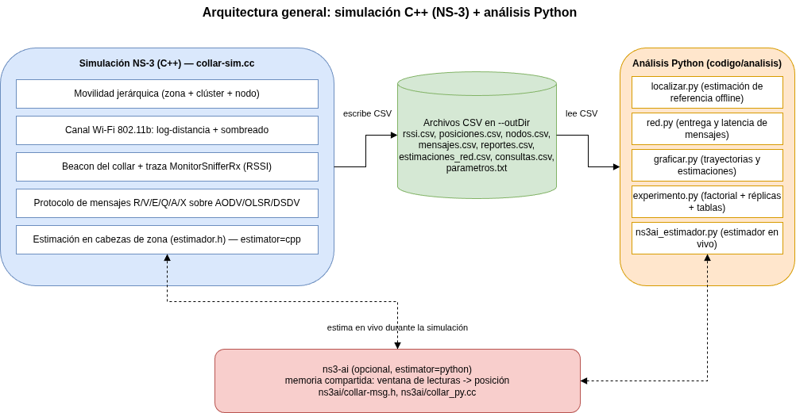
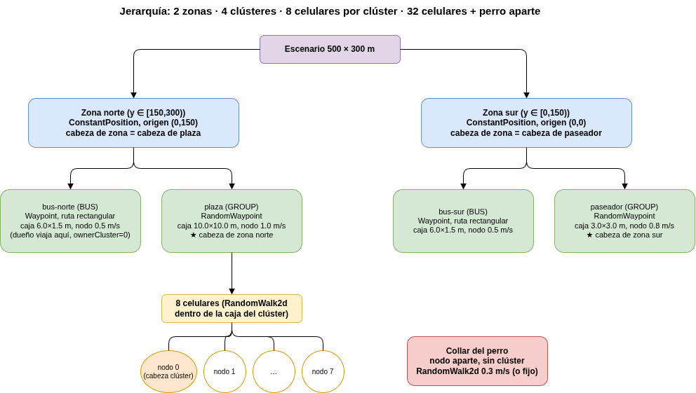
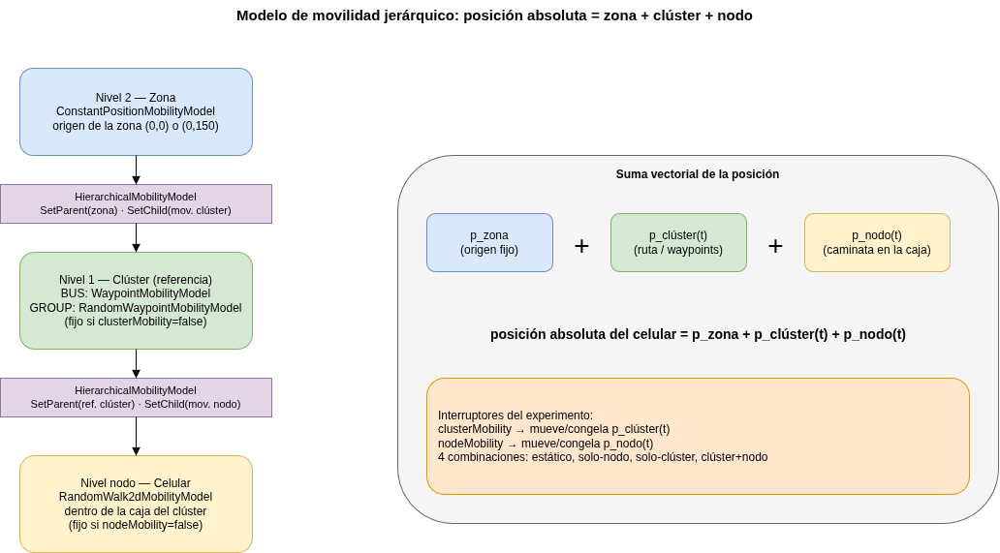
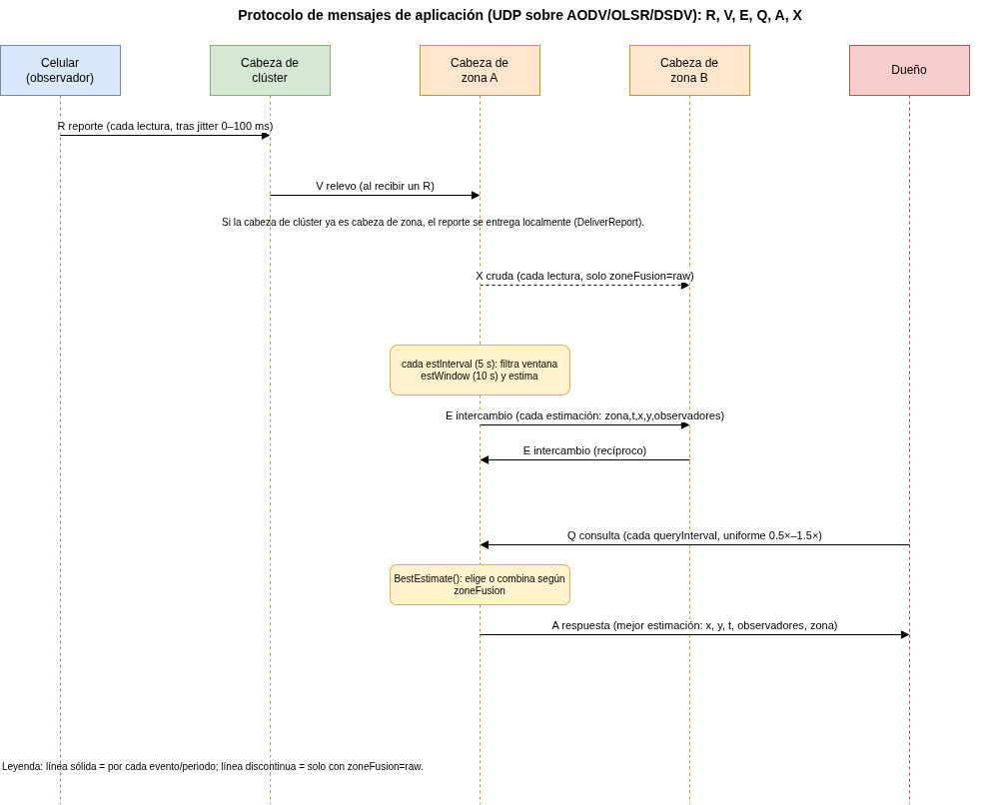
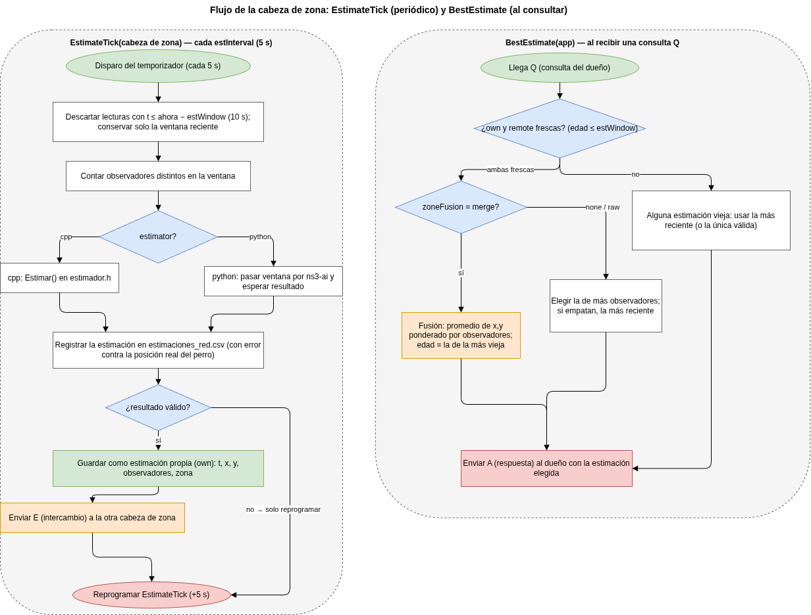
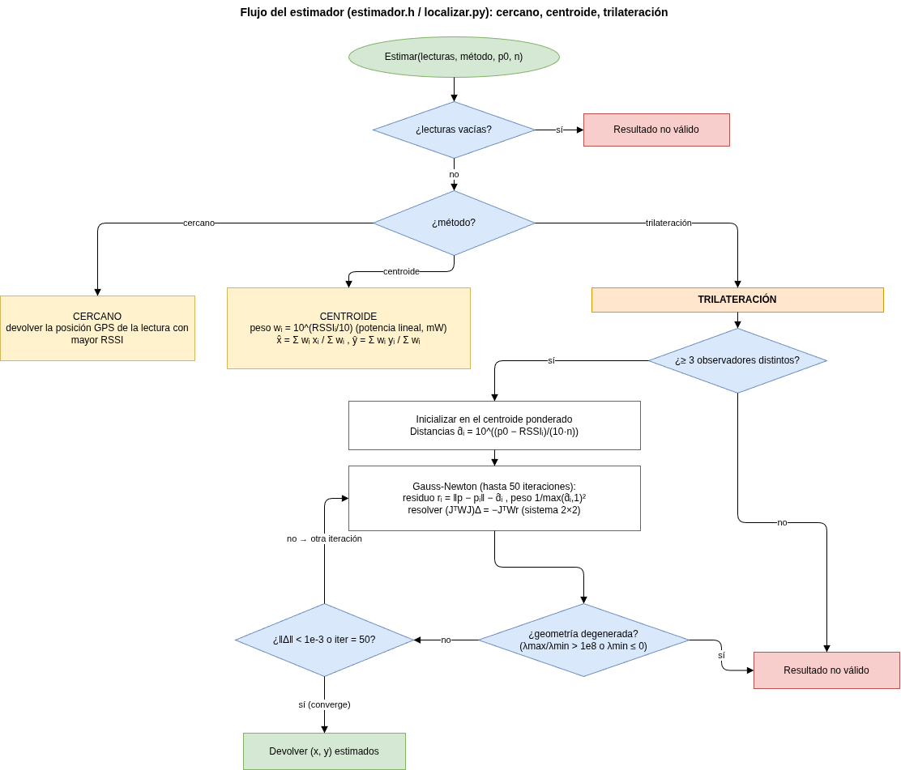
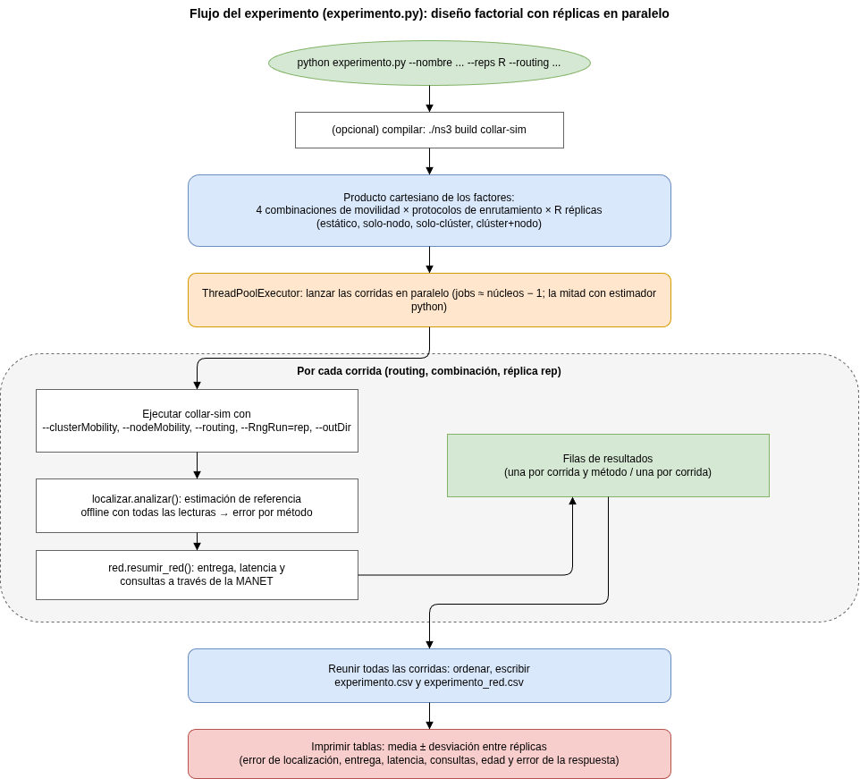

# Diseño de la solución

**Taller 01: Simulación de MANETs**

**ME01 — Modelos estocásticos y simulación en computación y comunicaciones**

**Universidad Nacional de Colombia**

## 1. Introducción

Este documento describe el diseño de la solución del Taller 01: una simulación de una red móvil ad
hoc (MANET) jerárquica en la que un conjunto de celulares escucha el *beacon* de radio de un collar
de perro, mide su intensidad de señal recibida (RSSI) y estima colaborativamente la posición del
collar, de modo que el dueño pueda consultarla a través de la misma red. El escenario es análogo al
servicio "Find My" de Apple y sirve para estudiar cómo influye el patrón de movilidad de los
observadores en la calidad de la localización.

La simulación se construye sobre NS-3 3.46.1 [4] en C++, y el análisis se realiza en Python. El
diseño responde a la pregunta de investigación acordada por el grupo: *¿cómo afecta el patrón de
movilidad de los celulares que observan al error y a la frescura de la posición estimada de un collar
por RSSI?* La variable independiente es el patrón de movilidad, controlado por dos interruptores
(movilidad de clúster y movilidad de nodo). Las variables medidas son el error de localización, la
frescura (edad) de la estimación y la tasa de consultas respondidas.

Las secciones siguientes presentan, en este orden: la arquitectura general (sección 2), la jerarquía
de la red (sección 3), el modelo de movilidad (sección 4), el protocolo de mensajes (sección 5), el
flujo de la cabeza de zona (sección 6), el flujo del estimador con sus fórmulas (sección 7), el flujo
del experimento (sección 8) y, por último, las decisiones de diseño y los supuestos a declarar
(sección 9). Todos los nombres, números y parámetros provienen del código real (`collar-sim.cc`,
`estimador.h`, `analisis/*.py`) y del contexto compartido del grupo. Este documento describe el
diseño, no resultados experimentales, que corresponden al literal f.

## 2. Arquitectura general

La solución tiene dos piezas que se comunican principalmente por archivos. El binario de simulación
en C++ (`collar-sim.cc`) ejecuta el escenario completo (movilidad jerárquica, canal de radio Wi-Fi,
protocolo de mensajes y estimación) y escribe el resultado de cada corrida como archivos CSV en el
directorio `--outDir`. Los scripts de Python de `codigo/analisis/` leen esos CSV para producir la
localización de referencia, las métricas de red, las gráficas y las tablas del experimento factorial.

Existe además un camino opcional en vivo mediante ns3-ai [5]: con `--estimator=python`, en cada
instante de estimación la simulación se detiene, entrega la ventana de lecturas a un proceso de
Python por memoria compartida y continúa con la posición que Python devuelve. Así se puede sustituir
el estimador (por ejemplo, por un filtro de Kalman o un modelo entrenado) sin modificar el código
C++. El estimador por defecto, en cambio, corre dentro de C++ (`estimator=cpp`). La figura 1 resume
esta arquitectura.

Los principales archivos de salida, escritos en `--outDir`, son: `rssi.csv` (cada lectura:
observador, GPS, posición real del perro, RSSI y distancia), `posiciones.csv` (posición de cada nodo
cada `posLogInterval`), `nodos.csv` (clúster, zona y rol de cada nodo), `mensajes.csv` (cada mensaje
con hora de envío y de llegada), `reportes.csv` (cada lectura con su hora de llegada a la cabeza de
zona), `estimaciones_red.csv` (cada estimación con su error contra la posición real), `consultas.csv`
(cada consulta con su demora, antigüedad y error) y `parametros.txt` / `parametros_texto.txt` (los
parámetros y la semilla de la corrida).

## 3. Jerarquía de la red

La topología es jerárquica de tres niveles. El escenario mide 500 × 300 m y se divide en dos zonas:
sur, con $y \in [0,150)$, y norte, con $y \in [150,300)$. Cada zona contiene dos clústeres (4 en
total), y cada clúster agrupa `nodesPerCluster` = 8 celulares, para 32 celulares en total. El collar
del perro es un nodo aparte que no pertenece a ningún clúster. La figura 2 muestra esta estructura.

Los cuatro clústeres (definidos en `kClusters` de `collar-sim.cc`) son:

| Clúster | Zona | Tipo | Caja de nodos (semi-ejes) | Rapidez de nodo |
|---|---|---|---|---|
| `bus-norte` | norte | BUS | 6.0 × 1.5 m | 0.5 m/s |
| `plaza` | norte | GROUP | 10.0 × 10.0 m | 1.0 m/s |
| `bus-sur` | sur | BUS | 6.0 × 1.5 m | 0.5 m/s |
| `paseador` | sur | GROUP | 3.0 × 3.0 m | 0.8 m/s |

Los clústeres de tipo BUS recorren una ruta rectangular con paradas; los de tipo GROUP se desplazan
como un grupo a pie. La ruta del bus, relativa al origen de su zona, es el rectángulo
(50,30) → (450,30) → (450,120) → (50,120), recorrido en bucle a `busSpeed` con una parada `busDwell`
en cada esquina.

La cabeza de cada clúster es su nodo 0. La cabeza de la zona norte es la cabeza del clúster `plaza` y
la de la zona sur es la del clúster `paseador` (según `kZones`: `norte.headCluster` = 1 → plaza,
`sur.headCluster` = 3 → paseador). El dueño del perro viaja en el clúster `bus-norte`
(`ownerCluster` = 0) y es el nodo 1 de ese clúster. El collar es un nodo independiente con
`RandomWalk2dMobilityModel` a 0.3 m/s (o fijo si `dogMobility=false`).

## 4. Modelo de movilidad

La posición absoluta de cada celular se construye como la suma de tres capas, usando
`HierarchicalMobilityModel` de NS-3. Cada capa aporta un desplazamiento: el nivel 2 fija el origen de
la zona, el nivel 1 mueve la referencia del clúster, y el nivel de nodo desplaza al celular dentro de
la caja de su clúster. La figura 3 ilustra la composición.

Los modelos de movilidad por nivel son los siguientes. En el nivel 2 (zona), un
`ConstantPositionMobilityModel` anclado en el origen de la zona ((0,0) para sur, (0,150) para norte);
es fijo. En el nivel 1 (clúster), para un BUS se usa `WaypointMobilityModel` siguiendo la ruta
rectangular con paradas, y para un GROUP, `RandomWaypointMobilityModel` con rapidez uniforme en
[`groupSpeedMin`, `groupSpeedMax`] y pausa uniforme en [0, `groupPause`]; si `clusterMobility=false`,
la referencia del clúster queda fija en su posición de inicio. En el nivel de nodo (celular), un
`RandomWalk2dMobilityModel` confinado a la caja del clúster (rectángulo de semi-ejes `halfX` ×
`halfY`), a la rapidez de nodo correspondiente; si `nodeMobility=false`, el celular queda fijo en su
posición inicial dentro de la caja.

El ensamblaje sigue el patrón de NS-3: se crea un `HierarchicalMobilityModel` con `SetParent(zona)` y
`SetChild(movilidad del clúster)` para la referencia del clúster, y luego cada nodo agrega otro
`HierarchicalMobilityModel` con esa referencia como padre y su propia caminata como hijo. Así, la
posición del celular es:

$$
\mathbf{p}_{\text{celular}}(t) = \mathbf{p}_{\text{zona}} + \mathbf{p}_{\text{clúster}}(t) + \mathbf{p}_{\text{nodo}}(t)
$$

Los dos interruptores del experimento actúan sobre esta suma: `clusterMobility` decide si
$\mathbf{p}_{\text{clúster}}(t)$ varía o queda congelado, y `nodeMobility` hace lo propio con
$\mathbf{p}_{\text{nodo}}(t)$. Sus cuatro combinaciones definen los escenarios de movilidad: estático
(ambos falsos), solo-nodo, solo-clúster y clúster+nodo (ambos verdaderos). Los modelos de movilidad
grupal y jerárquica son un tema central de las MANET [1].

## 5. Protocolo de mensajes

Sobre el protocolo de enrutamiento elegido (AODV [6], OLSR [7] o DSDV [8]), las aplicaciones de los
nodos intercambian mensajes UDP de seis tipos. La tabla siguiente resume quién envía cada tipo, a
quién y cuándo (derivada de la tabla del README y de `HandleMsg()`):

| Tipo | Nombre | De → a | Cuándo |
|---|---|---|---|
| R | reporte | celular → cabeza de su clúster | cada lectura, tras un jitter de 0–`reportJitterMs` |
| V | relevo | cabeza de clúster → cabeza de zona | al recibir un reporte R |
| E | intercambio | cabeza de zona → otra cabeza de zona | cada estimación (`estInterval`) |
| Q | consulta | dueño → cabeza de su zona | cada `queryInterval` (uniforme 0.5×–1.5×) |
| A | respuesta | cabeza de zona → dueño | al recibir una consulta Q |
| X | cruda | cabeza de zona → otra cabeza de zona | cada lectura, solo con `zoneFusion=raw` |

La lógica de encaminamiento de los reportes está en `HandleMsg()`. Cuando una lectura (R) llega a la
cabeza de un clúster que no es cabeza de zona, se reenvía como relevo (V) hacia la cabeza de zona; si
el nodo que la recibe ya es la cabeza de zona, la lectura se entrega localmente (`DeliverReport`). Las
cabezas de zona acumulan las lecturas en una ventana de tiempo. El mensaje X solo aparece con
`zoneFusion=raw`: la cabeza de zona reenvía cada lectura cruda a la otra cabeza, que la añade a su
ventana sin volver a reenviarla. La figura 4 muestra la secuencia.

Una particularidad del diseño es que las consultas del dueño no se emiten a intervalos fijos sino
uniformemente en [0.5×, 1.5×] `queryInterval`. Así se evita que las consultas caigan siempre en el
mismo punto del ciclo de estimación, lo que haría que la edad de la respuesta saliera artificialmente
constante.

## 6. Flujo de la cabeza de zona

Cada cabeza de zona cumple dos funciones: estimar periódicamente la posición del collar
(`EstimateTick`) y responder las consultas del dueño eligiendo o combinando las estimaciones
disponibles (`BestEstimate`). La figura 5 muestra ambos flujos.

`EstimateTick` se dispara cada `estInterval` (5 s). La cabeza de zona primero descarta las lecturas
más viejas que `estWindow` (10 s), conservando solo las de la ventana reciente; cuenta los
observadores distintos; estima la posición con la ventana (en C++ con `estimador.h`, o en Python vía
ns3-ai si `estimator=python`); y registra el resultado en `estimaciones_red.csv` junto con el error
contra la posición real del perro. Si el resultado es válido, lo guarda como su estimación propia
(`own`) y lo envía a la otra cabeza de zona mediante un mensaje E. Finalmente reprograma el siguiente
`EstimateTick` a +5 s.

`BestEstimate` se ejecuta al recibir una consulta Q. La cabeza de zona mantiene dos estimaciones: la
propia (`own`) y la última recibida de la otra zona (`remote`). Para contestar sigue estas reglas. Si
ambas están frescas (edad ≤ `estWindow`) y `zoneFusion=merge`, devuelve la fusión: el promedio de $x$
e $y$ ponderado por el número de observadores de cada una, con edad igual a la de la estimación más
vieja. Si ambas están frescas con `zoneFusion=none` o `raw`, devuelve la de más observadores, y en
caso de empate la más reciente. Si alguna no está fresca, devuelve la más reciente de las válidas (o
la única válida).

El resultado se envía al dueño en un mensaje A. Las tres opciones de `zoneFusion` determinan cómo se
combinan las dos zonas: `none` (cada cabeza estima solo con su zona), `raw` (cada cabeza reenvía sus
lecturas crudas a la otra, que estima con todo) y `merge` (cada una estima por su lado y se promedian
al contestar).

## 7. Flujo del estimador

El estimador es idéntico en C++ (`estimador.h`) y en Python (`analisis/localizar.py`), para que la
estimación dentro de la red (cabezas de zona) y la de referencia fuera de línea sean comparables.
Recibe la ventana de lecturas, cada una con el identificador del observador, su posición GPS
reportada y el RSSI, junto con los parámetros de canal $P_0$ y $n$, y aplica uno de tres métodos.
La figura 6 muestra el flujo completo.

Antes de estimar, la distancia asociada a un RSSI se obtiene invirtiendo el modelo de pérdida
log-distancia [1]:

$$
\hat{d}_i = 10^{\frac{P_0 - \text{RSSI}_i}{10\,n}}
$$

donde $P_0 = \text{collarTxDbm} - \text{refLossDb}$ es la potencia de referencia a 1 m y $n$ es el
exponente de pérdida (`pathLossExp`).

El método `cercano` es la línea base tipo Find My: devuelve la posición GPS de la lectura con el RSSI
más alto. No requiere más de una lectura.

El método `centroide` calcula el centroide de las posiciones GPS ponderado por la potencia lineal (en
mW). El peso de cada lectura es $w_i = 10^{\text{RSSI}_i/10}$ y la estimación es:

$$
\hat{x} = \frac{\sum_i w_i\, x_i}{\sum_i w_i}, \qquad
\hat{y} = \frac{\sum_i w_i\, y_i}{\sum_i w_i}
$$

El método `trilateracion` resuelve unos mínimos cuadrados no lineales por Gauss-Newton. Requiere al
menos 3 observadores distintos; si no los hay, no produce estimación. Parte del centroide ponderado
como punto inicial y, en cada iteración, para cada lectura calcula el residuo entre la distancia
geométrica al punto actual $\mathbf{p} = (x,y)$ y la distancia estimada por RSSI:

$$
r_i = \lVert \mathbf{p} - \mathbf{p}_i \rVert - \hat{d}_i
$$

Cada residuo se pondera con $w_i = 1/\max(\hat{d}_i, 1)^2$, de modo que las lecturas cercanas (más
confiables) pesan más. El paso de Gauss-Newton resuelve el sistema normal $2 \times 2$:

$$
(J^\top W J)\,\Delta = -\,J^\top W\, r
$$

donde $J$ es la matriz jacobiana cuyas filas son los vectores unitarios
$\left( \frac{x - x_i}{\lVert \mathbf{p}-\mathbf{p}_i\rVert},\ \frac{y - y_i}{\lVert \mathbf{p}-\mathbf{p}_i\rVert} \right)$
y $W$ es la matriz diagonal de pesos. La posición se actualiza $\mathbf{p} \leftarrow \mathbf{p} + \Delta$.

Para controlar geometrías degeneradas (por ejemplo, observadores casi colineales o casi en el mismo
punto), en cada iteración se estima el número de condición de la matriz normal simétrica $2\times 2$
a partir de sus valores propios $\lambda_{\max}$ y $\lambda_{\min}$. Si $\lambda_{\min} \le 0$ o
$\lambda_{\max}/\lambda_{\min} > 10^{8}$, la geometría se considera degenerada y no se devuelve
estimación. La iteración se detiene al converger ($\lVert \Delta \rVert < 10^{-3}$) o tras 50
iteraciones.

## 8. Flujo del experimento

El script `analisis/experimento.py` corre el diseño factorial completo. Los factores son las 4
combinaciones de movilidad (estático, solo-nodo, solo-clúster, clúster+nodo), los protocolos de
enrutamiento solicitados y las réplicas. Cada réplica se ejecuta con `--RngRun` distinto, de modo que
usa flujos de números aleatorios independientes. La figura 7 muestra el flujo.

El procedimiento es:

1. Opcionalmente recompilar el binario (`./ns3 build`).
2. Formar el producto cartesiano de factores: `routing` × combinación de movilidad × réplica.
3. Lanzar las corridas en paralelo con un `ThreadPoolExecutor` (por defecto, núcleos − 1; la mitad si
   el estimador corre en Python, porque cada corrida ocupa dos núcleos en espera activa). Cada corrida
   con `--estimator=python` crea su propia memoria compartida con nombre único, lo que permite
   paralelizarlas.
4. Por cada corrida: ejecutar `collar-sim` con los interruptores y la semilla correspondientes;
   calcular la localización de referencia offline con `localizar.analizar()` (error por método); y
   resumir la red con `red.resumir_red()` (entrega, latencia y consultas).
5. Reunir todas las filas, ordenarlas y escribir `experimento.csv` (una fila por corrida y método) y
   `experimento_red.csv` (una fila por corrida) en `resultados/<nombre>/`.
6. Imprimir las tablas con media ± desviación entre réplicas para las métricas: error mediano de
   localización, entrega de lecturas hacia la cabeza de zona, latencia mediana, consultas contestadas,
   RTT de la consulta, edad de la estimación recibida y error de la respuesta al dueño.

Lo que se pasa después de `--` en la línea de comandos se reenvía sin cambios a `collar-sim`, de
forma que todas las combinaciones comparten los mismos parámetros base. Este diseño de experimentos
con réplicas y control de factores es coherente con el enfoque de simulación de redes ad hoc en
ns-3 [2].

## 9. Decisiones de diseño y supuestos

Varias decisiones de diseño merecen declararse, en línea con la sección 12 ("efectos y artefactos del
modelo") del documento de hechos del sistema del grupo. Son supuestos y artefactos del modelo, no
conclusiones del experimento.

El estimador compartido C++/Python usa el mismo algoritmo (`estimador.h` y `localizar.py`) dentro de
la red y fuera de línea, para que la estimación de las cabezas de zona y la de referencia sean
directamente comparables. Se verificó que C++ y Python difieren en ≤ 3 cm en una corrida de
300 s [5].

La cola ARP se amplió porque NS-3 guarda por defecto solo 3 paquetes por vecino mientras resuelve
ARP; como los relevos salen en ráfaga (uno por beacon), se perdían muchos. El parámetro `arpQueue`
sube la cola a 64 para mitigar este artefacto. El efecto cuantitativo pertenece al literal f.

Sobre el sesgo de `zoneFusion=none`: con la fusión por defecto, cada cabeza de zona solo ve las
lecturas de su propia zona, de modo que su estimación se sesga hacia esa zona. Las opciones `raw` y
`merge` existen para estudiar ese sesgo.

El sombreado log-normal se sortea de forma independiente para cada paquete; en la realidad está
correlacionado en espacio y tiempo, por lo que promediar lecturas ayuda más en la simulación que en
la vida real. Este efecto, junto con la pérdida de lecturas lejanas con sombreado desfavorable, puede
sesgar el ajuste RSSI–distancia y hacer que la trilateración subestime distancias.

El diseño usa radio 802.11b en lugar de Bluetooth: un collar real usaría Bluetooth, pero como NS-3 no
lo trae, se emplea Wi-Fi ad hoc 802.11b como sustituto [4]. Las MANET y sus protocolos de
enrutamiento son el objeto de estudio del material del curso [1], [2].

Las consultas usan un intervalo aleatorio, uniforme en [0.5×, 1.5×] `queryInterval`, para desacoplar
las consultas del ciclo de estimación y no obtener edades artificialmente constantes.

Por último, el dimensionamiento de la jerarquía (número de zonas, clústeres y nodos por clúster) se
apoya en consideraciones de escalabilidad de redes ad hoc [3].

Los artefactos y porcentajes observados durante el desarrollo (pérdida de relevos, consultas sin
respuesta, efecto de `zoneFusion=raw`) están documentados en la sección 12 del documento de hechos
del sistema y deben tratarse como supuestos a declarar, no como resultados. Los resultados formales
de al menos tres escenarios son del literal f.

## 10. Referencias

- [1] S. K. Sarkar, T. G. Basavaraju, y C. Puttamadappa, *Ad Hoc Mobile Wireless Networks: Principles, Protocols, and Applications*, 2.ª ed. Boca Raton, FL, EE. UU.: CRC Press, 2013.
- [2] H. Zárate Ceballos, J. Parra Amaris, H. Jiménez Jiménez, D. Romero Rincón, O. Agudelo Rojas, y J. E. Ortiz Triviño, *Wireless Network Simulation: A Guide using Ad Hoc Networks and the ns-3 Simulator*.
- [3] J. P. Ospina-López y J. E. Ortiz-Triviño, "Estimation of a growth factor to achieve scalable ad hoc networks", *Ingeniería y Universidad*, vol. 21, n.º 1, pp. 49–70, 2017, doi: 10.11144/Javeriana.iyu21-1.egfa.
- [4] nsnam, "ns-3 Network Simulator", versión 3.46. [En línea]. Disponible: https://www.nsnam.org/
- [5] H. Yin *et al.*, "ns3-ai: Fostering Artificial Intelligence Algorithms for Networking Research", en *Proc. Workshop on ns-3 (WNS3)*, 2020. [En línea]. Disponible: https://github.com/hust-diangroup/ns3-ai
- [6] C. Perkins, E. Belding-Royer, y S. Das, "Ad hoc On-Demand Distance Vector (AODV) Routing", IETF, RFC 3561, jul. 2003.
- [7] T. Clausen y P. Jacquet, "Optimized Link State Routing Protocol (OLSR)", IETF, RFC 3626, oct. 2003.
- [8] C. E. Perkins y P. Bhagwat, "Highly dynamic Destination-Sequenced Distance-Vector routing (DSDV) for mobile computers", en *Proc. ACM SIGCOMM*, 1994, pp. 234–244.
