<div align="center">

# Experimentación y análisis de resultados

**Taller 01: Simulación de MANETs**

**ME01 — Modelos estocásticos y simulación en computación y comunicaciones**

**Universidad Nacional de Colombia**
</div>

Este informe presenta los siete niveles experimentales ejecutados, las estadísticas descriptivas y
los intervalos de confianza calculados entre réplicas. Los CSV agregados por réplica y los comandos
efectivamente usados se adjuntan en [`datos/`](./datos/README.md).

## 1. Diseño del experimento

El experimento responde la pregunta del literal b: cómo afecta el patrón de movilidad al error y a la
frescura de la localización por RSSI. Se usa un diseño factorial con réplicas, descrito en el
literal c (Sección 8) y automatizado en `analisis/experimento.py`.

**Factores y niveles.**

| Factor | Niveles | Cómo se controla |
|---|---|---|
| Movilidad de clúster | sí / no (`clusterMobility`) | lo cruza `experimento.py` |
| Movilidad de nodo | sí / no (`nodeMobility`) | lo cruza `experimento.py` |
| Protocolo de enrutamiento | `aodv`, `olsr`, `dsdv` | opción `--routing` |
| Densidad | 4, 8 (base), 16 nodos por clúster | `nodesPerCluster` en el `.conf` |
| Sombreado | 0, 4 (base), 8 dB | `shadowSigmaDb` en el `.conf` |
| Fusión de zonas | `none`, `raw`, `merge` | `zoneFusion` en el `.conf` |

La combinación de movilidad de clúster y de nodo da los cuatro escenarios de movilidad: estático,
solo-nodo, solo-clúster y clúster+nodo.

**Réplicas y semillas.** Cada combinación de movilidad y protocolo se corrió 10 veces con
`--RngRun` distinto. Los intervalos de confianza del 95% de la media se calcularon entre réplicas.

**Duración.** Cada corrida simula 600 s. Los siete niveles suman 7 × 4 combinaciones de movilidad ×
3 protocolos × 10 réplicas = **840 corridas**.

**Variables de respuesta.** Error de localización (m), frescura o edad de la estimación (s) y tasa de
consultas respondidas; su origen en los CSV está en el literal b (Sección 5.2).

**Fundamento de los factores.** Se comparan AODV, protocolo reactivo bajo demanda [6]; OLSR, protocolo
proactivo que usa relevos multipunto [7]; y DSDV, vector de distancias con números de secuencia [8].
La movilidad se varía porque la elección del modelo de movilidad puede alterar el rendimiento
observado de los protocolos MANET [10]. Para el canal, el modelo de referencia es pérdida log-distancia
con sombreado aleatorio en dB [9]; ns-3 documenta el modelo de propagación y sus parámetros [12].
Los valores concretos usados aquí (`pathLossExp=2.7`, `shadowSigmaDb=0`, 4 u 8 dB) son niveles de
este experimento, no valores universales ni una calibración de campo.

## 2. Escenarios

Se estudian cuatro escenarios; E2, E3 y E4 tienen dos niveles alternativos además del nivel base E1.
Esto permite comprobar si la respuesta cambia al variar densidad, sombreado o fusión de zonas. En
cada nivel, `experimento.py` cruza las cuatro combinaciones de movilidad con los tres protocolos.

| # | Nombre | Archivo(s) de parámetros | Qué cambia frente a `base.conf` | Qué prueba |
|---|---|---|---|---|
| E1 | Caso base | `E1.conf` | nada (valores por defecto) | el efecto de la movilidad en condiciones por defecto |
| E2 | Densidad | `E2-densidad-baja.conf` (`nodesPerCluster=4`), `E2-densidad-alta.conf` (`=16`) | observadores por clúster (base: 8) | si más observadores compensan la mala geometría del bus |
| E3 | Sombreado | `E3-sombreado-cero.conf` (`shadowSigmaDb=0`), `E3-sombreado-alto.conf` (`=8`) | ruido del canal (base: 4 dB) | si el patrón de movilidad que gana cambia con el ruido del canal |
| E4 | Fusión de zonas | `E4-fusion-raw.conf`, `E4-fusion-merge.conf` (el nivel `none` es E1) | `zoneFusion` (base: none) | si la forma de combinar las dos zonas altera la conclusión |

Los archivos `.conf` están en `codigo/escenarios/`. Cada uno trae un comentario con su propósito y el
comando para correrlo. E2, E3 y E4 tienen más de un nivel, de modo que cada nivel es una corrida
aparte; `experimento.py` fija un solo valor del `.conf` por corrida y lo cruza con las movilidades y
los protocolos.

### Cómo generar los datos

Desde `codigo/`, con el entorno cargado (`source entorno.sh`):

```bash
# E1 — caso base
python analisis/experimento.py --nombre E1 --reps 10 --routing aodv olsr dsdv -- --conf=escenarios/E1.conf

# E2 — densidad (dos niveles)
python analisis/experimento.py --nombre E2-densidad-baja --reps 10 --routing aodv olsr dsdv -- --conf=escenarios/E2-densidad-baja.conf
python analisis/experimento.py --nombre E2-densidad-alta --reps 10 --routing aodv olsr dsdv -- --conf=escenarios/E2-densidad-alta.conf

# E3 — sombreado (dos niveles)
python analisis/experimento.py --nombre E3-sombreado-cero --reps 10 --routing aodv olsr dsdv -- --conf=escenarios/E3-sombreado-cero.conf
python analisis/experimento.py --nombre E3-sombreado-alto --reps 10 --routing aodv olsr dsdv -- --conf=escenarios/E3-sombreado-alto.conf

# E4 — fusión de zonas (none ya es E1; raw y merge son niveles adicionales)
python analisis/experimento.py --nombre E4-fusion-raw   --reps 10 --routing aodv olsr dsdv -- --conf=escenarios/E4-fusion-raw.conf
python analisis/experimento.py --nombre E4-fusion-merge --reps 10 --routing aodv olsr dsdv -- --conf=escenarios/E4-fusion-merge.conf
```

Cada comando deja en `codigo/resultados/<nombre>/`: `experimento.csv` (error de localización por
método y réplica), `experimento_red.csv` (métricas de red y de consultas por réplica) y `comando.txt`
(el comando exacto, para reproducir). Para la figura de una corrida suelta:

```bash
python analisis/graficar.py resultados/<carpeta_de_una_corrida>
```

Cada comando ejecuta 120 corridas de 600 s. Los siete conjuntos de resultados se incluyen en
[`datos/`](./datos/README.md); cada uno contiene las filas por réplica, los intervalos calculados y
el comando guardado durante la ejecución.

## 3. Resultados por escenario

Las tablas presentan la media entre réplicas y, entre corchetes, su IC95% (límite inferior–superior).
Para comparar los niveles secundarios se fija AODV, movilidad `cluster+nodo`, estimador C++ y
trilateración; E1 es el nivel base común. Las tablas de localización usan `experimento.csv`; las de
red, `experimento_red.csv`. Los datos completos por réplica y todos los intervalos están en
[`datos/`](./datos/README.md).

### 3.1 E1 — Caso base

Resultados de localización con AODV y trilateración:

| Movilidad | Error mediano (m), media [IC95%] | Disponibilidad, % [IC95%] | Frescura media (s) [IC95%] |
|---|---:|---:|---:|
| Estático | 121.33 [98.17–144.50] | 97.6 [95.3–99.9] | 1.15 [0.93–1.37] |
| Solo nodo | 119.35 [95.84–142.86] | 97.0 [94.3–99.7] | 1.09 [0.83–1.35] |
| Solo clúster | 48.92 [39.28–58.56] | 88.6 [80.5–96.7] | 1.70 [1.01–2.39] |
| Clúster + nodo | 52.95 [44.39–61.50] | 96.3 [93.9–98.7] | 0.99 [0.76–1.21] |

Resultados de red y consultas para las mismas combinaciones (medias [IC95%]):

| Movilidad | Consultas exitosas, % | Error de respuesta (m) | Edad de respuesta (s) | Bytes de aplicación |
|---|---:|---:|---:|---:|
| Estático | 81.4 [73.5–89.2] | 101.02 [83.29–118.75] | 3.14 [2.62–3.66] | 37 597 [30 847–44 346] |
| Solo nodo | 84.7 [80.0–89.3] | 104.03 [89.90–118.16] | 2.83 [2.58–3.08] | 43 057 [33 278–52 835] |
| Solo clúster | 81.8 [73.8–89.8] | 78.07 [72.02–84.11] | 3.20 [2.72–3.69] | 137 956 [117 287–158 625] |
| Clúster + nodo | 73.8 [64.8–82.8] | 84.05 [70.67–97.43] | 2.90 [2.56–3.25] | 142 034 [127 276–156 792] |

Con movilidad `cluster+nodo` y trilateración, comparación descriptiva de protocolos (medias [IC95%]):

| Protocolo | Error mediano (m) | Frescura media (s) | Consultas exitosas, % | Error de respuesta (m) |
|---|---:|---:|---:|---:|
| AODV | 52.95 [44.39–61.50] | 0.99 [0.76–1.21] | 73.8 [64.8–82.8] | 84.05 [70.67–97.43] |
| OLSR | 50.23 [43.13–57.33] | 0.72 [0.60–0.83] | 95.3 [92.0–97.0] | 76.79 [70.08–83.50] |
| DSDV | 50.44 [42.85–58.04] | 0.79 [0.65–0.92] | 96.0 [94.0–98.0] | 85.43 [75.11–95.75] |

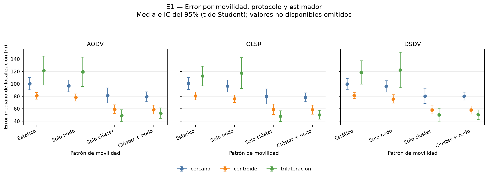

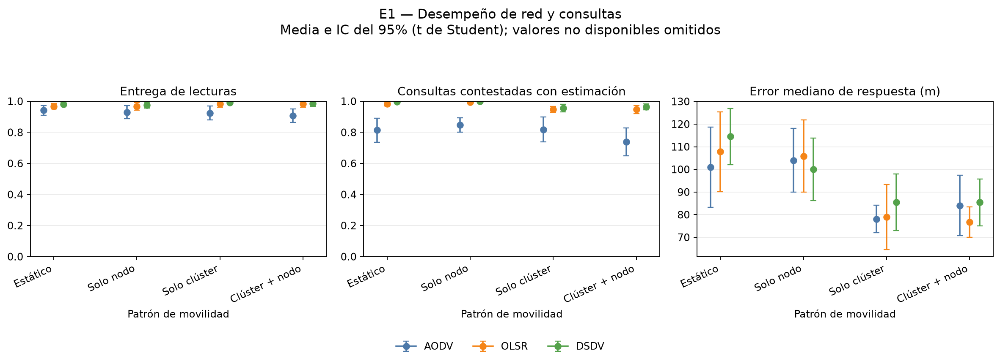

En esta muestra, permitir la movilidad del clúster coincide con una reducción marcada del error
mediano de localización respecto a los tratamientos sin movilidad de clúster. La combinación de
ambos niveles móviles mantiene un error bajo y una frescura cercana a 1 s, aunque genera más tráfico
de aplicación que los tratamientos con clúster fijo. Los IC95% de error de los tratamientos móviles
no se solapan con los de los tratamientos sin movilidad de clúster; esto es descriptivo y no
sustituye una prueba formal.

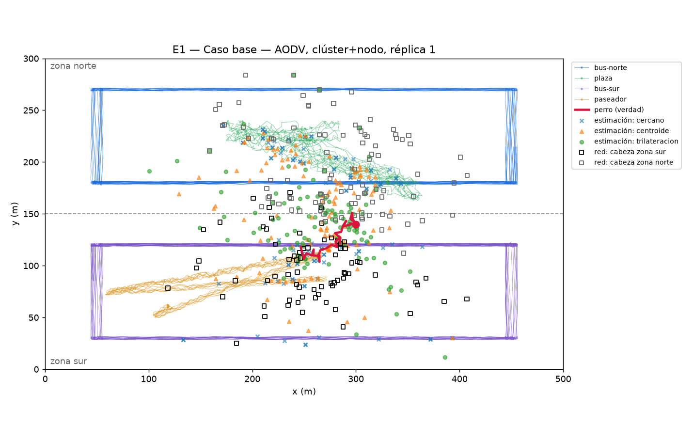

### 3.2 E2 — Densidad (baja vs alta)

Comparación con E1 (8 nodos por clúster); valores de localización como media [IC95%]:

| Nodos por clúster | Error mediano (m) | Disponibilidad, % | Frescura media (s) |
|---:|---:|---:|---:|
| 4 | 57.08 [51.45–62.71] | 76.0 [65.0–86.9] | 2.77 [1.20–4.33] |
| 8 (base) | 52.95 [44.39–61.50] | 96.3 [93.9–98.7] | 0.99 [0.76–1.21] |
| 16 | 51.77 [43.60–59.94] | 87.6 [81.7–93.5] | 2.19 [1.52–2.86] |

| Nodos por clúster | Consultas exitosas, % | Error de respuesta (m) | Edad de respuesta (s) | Bytes de aplicación |
|---:|---:|---:|---:|---:|
| 4 | 90.1 [86.1–94.1] | 92.90 [83.65–102.14] | 3.87 [2.89–4.85] | 66 986 [57 142–76 830] |
| 8 (base) | 73.8 [64.8–82.8] | 84.05 [70.67–97.43] | 2.90 [2.56–3.25] | 142 034 [127 276–156 792] |
| 16 | 61.2 [52.1–70.3] | 80.45 [69.72–91.19] | 3.27 [2.62–3.92] | 212 296 [177 324–247 268] |

Al aumentar la densidad de 4 a 16 nodos, el error mediano cambia poco frente a la amplitud de sus
intervalos, pero la disponibilidad no crece de forma monótona y el tráfico de aplicación sí aumenta.
En estos resultados, el nivel base de 8 supera a ambos niveles en disponibilidad y frescura; por
tanto, más observadores no garantizan por sí solos una mejor estimación o una respuesta más oportuna.

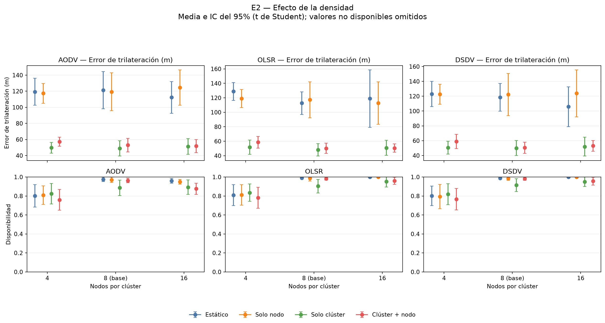

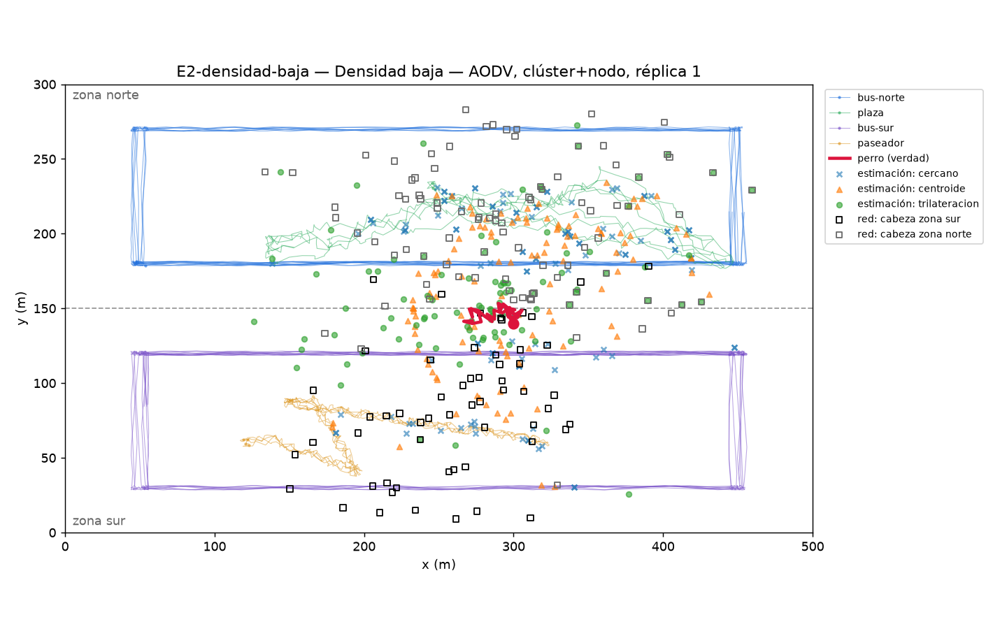

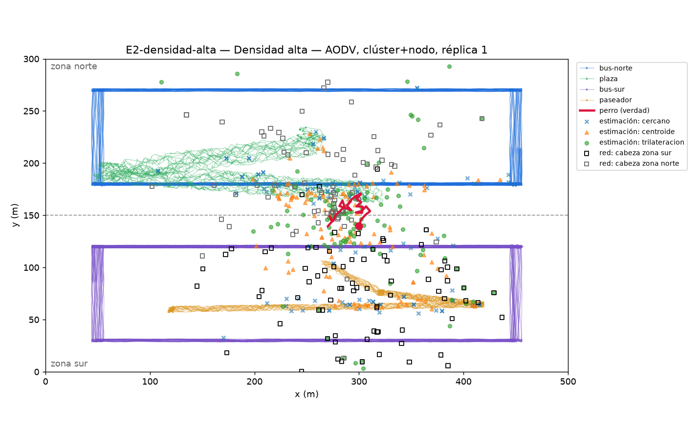

### 3.3 E3 — Sombreado (cero vs alto)

Comparar `E3-sombreado-cero` (0 dB) con `E3-sombreado-alto` (8 dB) y con el caso base (4 dB, de E1).

| Sombreado (dB) | Error mediano (m) | Disponibilidad, % | Frescura media (s) |
|---:|---:|---:|---:|
| 0 | 7.94 [3.18–12.70] | 44.2 [36.6–51.8] | 41.74 [31.10–52.38] |
| 4 (base) | 52.95 [44.39–61.50] | 96.3 [93.9–98.7] | 0.99 [0.76–1.21] |
| 8 | 60.15 [55.68–64.62] | 100.0 [100.0–100.0] | 0.65 [0.58–0.73] |

| Sombreado (dB) | Consultas exitosas, % | Error de respuesta (m) | Edad de respuesta (s) | Bytes de aplicación |
|---:|---:|---:|---:|---:|
| 0 | 83.5 [77.0–90.0] | 32.49 [11.55–53.42] | 11.56 [1.80–21.31] | 115 270 [95 830–134 710] |
| 4 (base) | 73.8 [64.8–82.8] | 84.05 [70.67–97.43] | 2.90 [2.56–3.25] | 142 034 [127 276–156 792] |
| 8 | 66.0 [57.8–74.3] | 110.01 [101.03–118.99] | 2.74 [2.39–3.09] | 202 072 [191 513–212 631] |

Sin sombreado se observa un error menor entre las estimaciones disponibles, pero la disponibilidad
baja a 44.2% y la frescura media sube a 41.7 s; el error aislado no describe la utilidad total del
sistema. Con 8 dB las estimaciones están disponibles en todas las ventanas de esta combinación,
pero el error de localización y el de respuesta son mayores. El sombreado altera conjuntamente
precisión, disponibilidad y edad, por lo que conviene leer estas métricas como un compromiso y no
elegir un nivel solo por el error mediano.

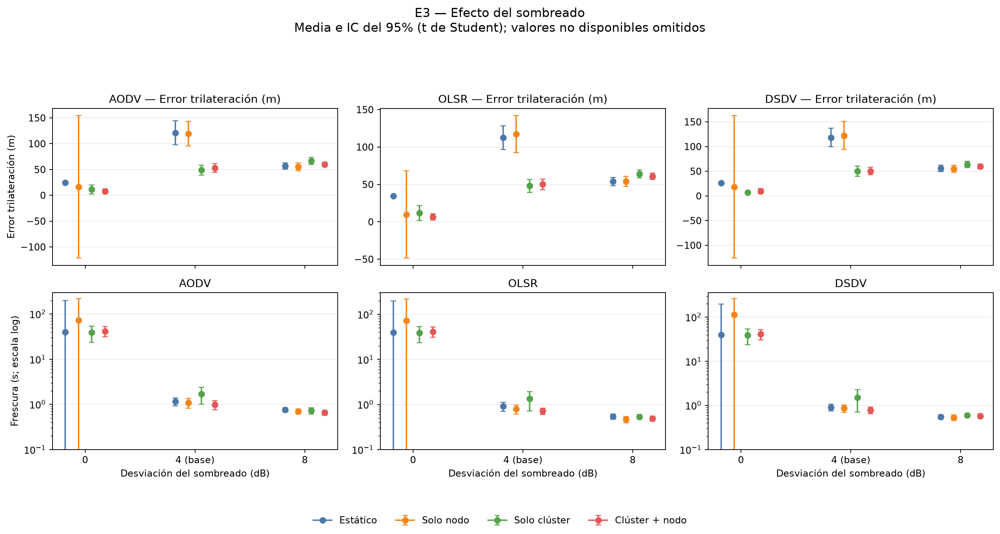

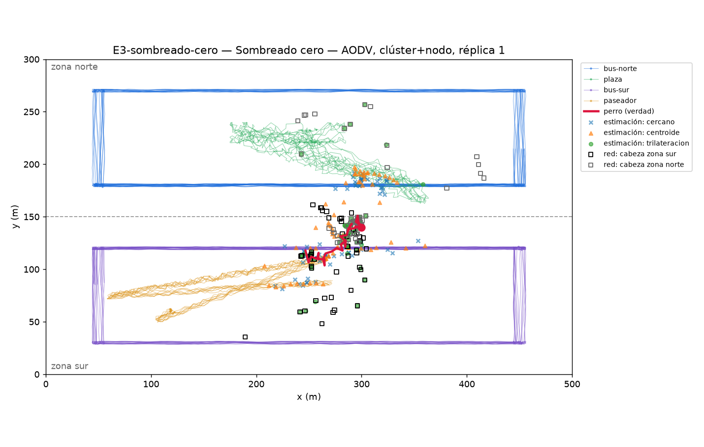

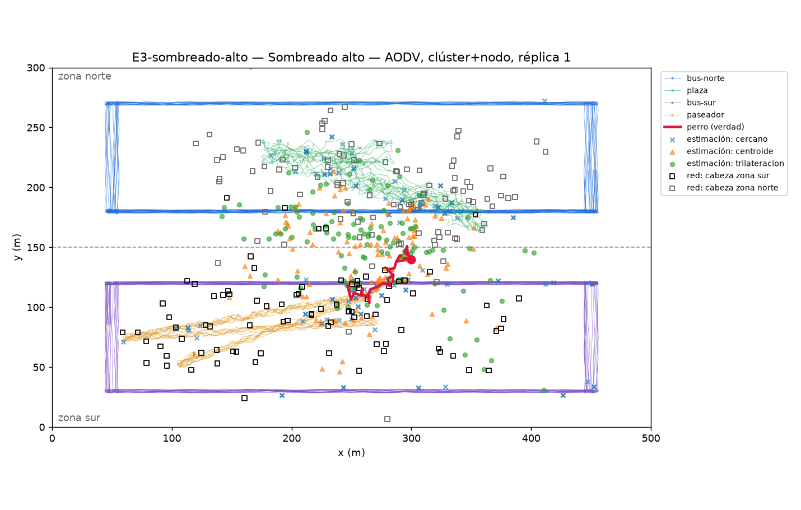

### 3.4 E4 — Fusión de zonas (none vs raw vs merge)

Comparar `none` (de E1), `E4-fusion-raw` y `E4-fusion-merge`.

| `zoneFusion` | Error de respuesta (m) | Consultas exitosas, % | Edad de respuesta (s) | Bytes de aplicación |
|---|---:|---:|---:|---:|
| `none` (base) | 84.05 [70.67–97.43] | 73.8 [64.8–82.8] | 2.90 [2.56–3.25] | 142 034 [127 276–156 792] |
| `raw` | 50.78 [41.84–59.72] | 79.2 [72.5–85.8] | 2.70 [2.49–2.91] | 246 250 [209 626–282 873] |
| `merge` | 65.07 [59.72–70.41] | 74.2 [65.2–83.2] | 3.08 [2.80–3.35] | 139 564 [122 934–156 195] |

En la combinación seleccionada, `raw` presenta menor error de respuesta y una proporción de
consultas exitosas algo mayor que `none`, a costa de aproximadamente 73% más bytes de aplicación.
`merge` reduce el error respecto a `none` con un volumen de bytes parecido. Sus IC95% del error
apenas dejan de solaparse (por unos 0.26 m); esta separación descriptiva no sustituye una prueba
formal.

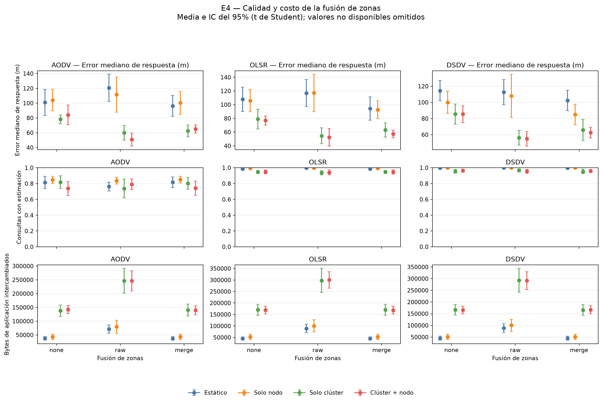

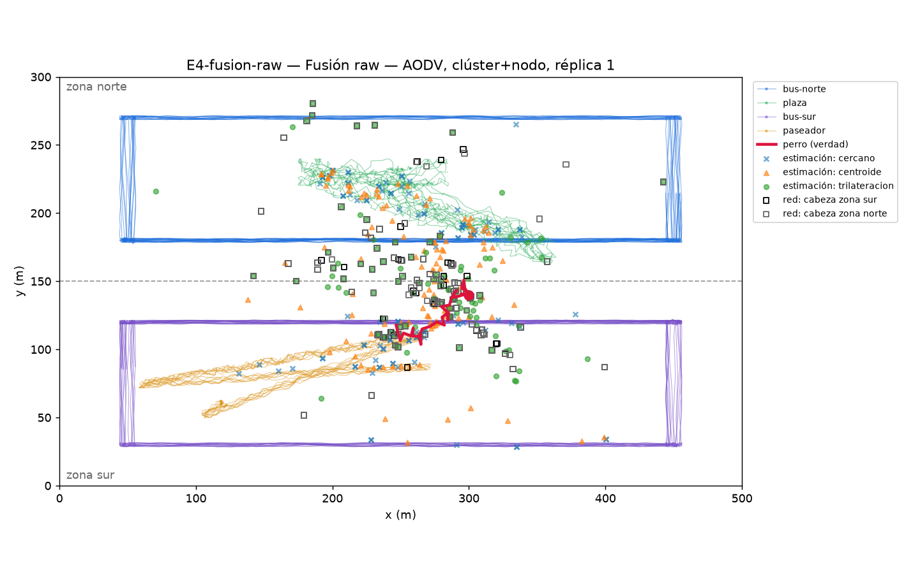

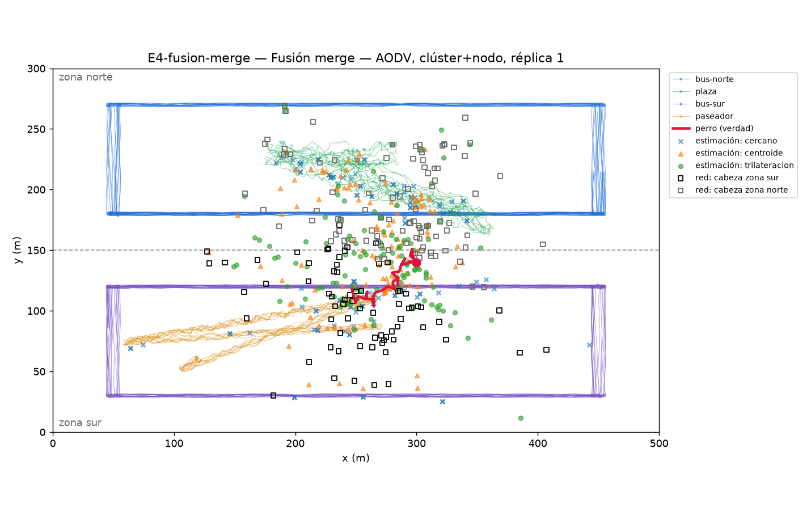

Las gráficas comparativas se generan desde `codigo/` con:

```bash
python analisis/graficas_comparativas.py
```

El script lee los siete CSV agregados de `resultados/` y guarda las figuras en
`entregables/f-experimentacion/figuras/`. Cada punto muestra la media entre réplicas y cada barra
el intervalo de confianza del 95% para la media, calculado con t de Student; en las comparaciones
de densidad y sombreado, E1 sirve como nivel base. También guarda
`resultados/<escenario>/intervalos_confianza.csv`, con el tamaño de muestra válido, media,
desviación estándar e intervalo inferior/superior para cada métrica y combinación. Los valores no
disponibles se excluyen y el número `n` refleja cuántas réplicas válidas entraron en cada cálculo.
Con más de 30 grados de libertad se usa una aproximación de Cornish-Fisher al valor crítico de t.
El solapamiento de intervalos es descriptivo y no reemplaza una prueba formal de hipótesis.

Las Figuras F6–F12 son visualizaciones cualitativas de la salida de una sola corrida por nivel.
Para mantener la comparación controlada, se escogió en todos los casos AODV, `cluster+nodo` y
`run01`; no sustituyen los promedios ni los intervalos calculados sobre todas las réplicas. Se
generan desde `codigo/` con `python analisis/graficar.py <corrida> --salida <archivo.png> --titulo
<título>`.

### Animaciones NetAnim

Se adjuntan siete trazas XML, una para cada nivel ejecutado: E1, los dos niveles de E2, los dos de
E3 y los dos niveles adicionales de E4. Todas usan AODV, movilidad `cluster+nodo`, `RngRun=1` y
120 s de simulación para facilitar una inspección visual breve y comparable. Las genera
`ns3::AnimationInterface`; NetAnim carga estas trazas para animar la topología y las trayectorias
de los nodos [13]. El collar rojo representa la posición real; los marcadores magenta y cian
representan, respectivamente, las estimaciones válidas de las cabezas de zona sur y norte. El
marcador gris en el centro de una zona indica que aún no hay estimación válida. El registro de
paquetes está desactivado, y las filas completas de cada estimación se conservan en
`estimaciones_red.csv`. Los siete XML están en [`animaciones/`](./animaciones/README.md):
`E1.xml`, `E2-densidad-baja.xml`, `E2-densidad-alta.xml`, `E3-sombreado-cero.xml`,
`E3-sombreado-alto.xml`, `E4-fusion-raw.xml` y `E4-fusion-merge.xml`. Son corridas ilustrativas,
no nuevas réplicas estadísticas ni evidencia de promedios; las estadísticas del informe siguen
basadas en las corridas de 600 s.

Los GIF de esa carpeta permiten ver las mismas corridas sin abrir NetAnim. En su leyenda, **Collar:
posición real** es la ubicación verdadera del perro; **Estimación zona sur/norte** es la posición
estimada por la cabeza de esa zona; y **Estimación no disponible** indica que todavía no existe una
estimación válida. Los demás colores identifican los clústeres: bus-norte (azul), plaza (verde),
bus-sur (violeta) y paseador (naranja); cada punto pequeño representa un celular. Las etiquetas
`HZ-S` y `HZ-N` marcan las cabezas de zona, `D` al dueño, y la línea horizontal separa las zonas
norte y sur. Los diamantes magenta y cian son las estimaciones sur y norte; el gris indica que falta
una estimación válida.

## 4. Análisis

En E1, los tratamientos con movilidad de clúster tienen menor error mediano que los tratamientos sin
ella en la comparación AODV/trilateración. La configuración `cluster+nodo` combina error mediano de
52.95 m y frescura media de 0.99 s; `solo-clúster` logra un error similar (48.92 m), pero con menor
disponibilidad (88.6%) y una frescura mayor (1.70 s). Por tanto, en estos resultados la movilidad
afecta tanto la geometría de las lecturas como la oportunidad de las estimaciones; no hay una única
configuración que optimice simultáneamente todas las métricas.

El protocolo también se asocia con diferencias en entrega de consultas: para `cluster+nodo`,
OLSR y DSDV responden alrededor del 95–96% de las consultas frente al 73.8% de AODV. Sus
intervalos para éxito de consultas no se solapan con el de AODV en esta muestra. A la vez, el
volumen de bytes de aplicación es mayor con OLSR y DSDV que con AODV. Esta comparación es
descriptiva para el tratamiento mostrado, no una prueba causal general sobre los protocolos.

En E2, aumentar nodos por clúster no mejora de forma clara el error mediano: los IC de 4, 8 y 16
nodos se solapan ampliamente. La disponibilidad es mayor con 8 que con 4 o 16 nodos en la
combinación reportada, y 16 nodos aumenta el tráfico. El beneficio de densidad depende de más que
el número de observadores; la distribución espacial y las entregas de red también importan.

En E3, el sombreado cero produce un error mediano bajo entre las estimaciones disponibles, pero
solo hay disponibilidad de 44.2% y la frescura media es de 41.7 s. Con sombreado de 8 dB, la
disponibilidad es completa en esta combinación, pero suben los errores de localización y respuesta.
La diferencia evidencia por qué error, disponibilidad y edad deben analizarse conjuntamente.

En E4, `raw` reduce el error mediano de respuesta frente a `none` y eleva modestamente el éxito de
consultas, con mayor tráfico de aplicación. `merge` queda entre ambos en error y mantiene un tráfico
similar a `none`. Los IC95% del error de `none` y `merge` apenas dejan de solaparse (por unos
0.26 m); esta separación descriptiva no sustituye una prueba formal.

Los IC95% resumen la incertidumbre de la media entre las réplicas del tratamiento concreto. El
solapamiento o separación de intervalos sirve aquí como referencia visual, no como prueba de
hipótesis; no se ejecutó una prueba formal ni se corrigió por comparaciones múltiples. Las tablas de
este informe usan 10 réplicas válidas. En algunos grupos de `E3-sombreado-cero` para otros
protocolos, movilidades o métricas hay menos datos válidos —incluidos grupos sin observaciones—;
el `n` de cada fila en los CSV adjuntos permite identificarlos. La inspección del solapamiento de
intervalos no equivale por sí sola a una prueba de significancia estadística [11].

> Antes de concluir, revisar la sección "Qué declarar en el informe" del README del repositorio y la
> Sección 7 del literal b: hay artefactos del modelo (sesgo de lecturas lejanas, sombreado
> independiente por paquete, cola ARP, caducidad de rutas en AODV, sesgo de `zoneFusion=none`) que
> pueden confundir el análisis y deben tenerse en cuenta al interpretar los números.

## 5. Conclusiones

Los resultados apoyan parcialmente que la movilidad de clúster mejora la localización: en E1,
`solo-clúster` y `cluster+nodo` muestran menor error mediano que los tratamientos sin movilidad de
clúster, en la comparación AODV/trilateración. Sin embargo, varían la disponibilidad, la frescura y
el tráfico, por lo que la ventaja no implica una mejora uniforme de todos los indicadores.

Los niveles secundarios modifican esa conclusión. La densidad alta eleva el tráfico sin reducir de
forma clara el error; el sombreado cambia drásticamente la disponibilidad y la edad de las
estimaciones; y `raw` mejora el error de respuesta en la combinación medida, a costa de tráfico
adicional. En consecuencia, la elección debe considerar conjuntamente precisión, disponibilidad,
frescura y costo de comunicación.

Estos hallazgos describen las condiciones simuladas y no deben extrapolarse directamente a una red
real. Las diferencias entre intervalos no sustituyen contrastes estadísticos formales.

## 6. Recomendaciones y trabajo futuro

- Elegir el protocolo y el modo de fusión según el compromiso requerido entre éxito de consultas,
  error de respuesta y bytes transmitidos; no seleccionar solo por precisión.
- Repetir y ampliar los tratamientos de sombreado cero, ya que algunos grupos tuvieron pocas o
  ninguna observación válida y una frescura muy alta.
- Añadir contrastes formales entre tratamientos e interacciones, con un plan de comparaciones
  definido antes del análisis.
- Como extensiones del modelo, estudiar sombreado correlacionado espacial y temporalmente, medir
  distancias con tecnologías como Wi-Fi FTM y evaluar estimadores temporales (por ejemplo, un filtro
  de Kalman integrado mediante ns3-ai).

## 7. Referencias

- **[6]** C. Perkins, E. Belding-Royer, y S. Das, “Ad hoc On-Demand Distance Vector (AODV)
  Routing,” IETF, RFC 3561, jul. 2003. [En línea]. Disponible:
  https://www.rfc-editor.org/rfc/rfc3561.html.
- **[7]** T. Clausen y P. Jacquet, “Optimized Link State Routing Protocol (OLSR),” IETF, RFC 3626,
  oct. 2003. [En línea]. Disponible: https://www.rfc-editor.org/rfc/rfc3626.html.
- **[8]** C. E. Perkins y P. Bhagwat, “Highly dynamic Destination-Sequenced Distance-Vector routing
  (DSDV) for mobile computers,” en *Proc. ACM SIGCOMM*, 1994, pp. 234–244,
  doi: 10.1145/190314.190336.
- **[9]** T. S. Rappaport, *Wireless Communications: Principles and Practice*, 2.ª ed. Upper Saddle
  River, NJ, EE. UU.: Prentice Hall PTR, 2002.
- **[10]** T. Camp, J. Boleng, y V. Davies, “A survey of mobility models for ad hoc network
  research,” *Wireless Communications and Mobile Computing*, vol. 2, n.º 5, pp. 483–502, 2002,
  doi: 10.1002/wcm.72.
- **[11]** M. E. Payton, M. H. Greenstone, y N. Schenker, “Overlapping confidence intervals or
  standard error intervals: What do they mean in terms of statistical significance?,” *Journal of
  Insect Science*, vol. 3, n.º 1, art. 34, 2003, doi: 10.1093/jis/3.1.34.
- **[12]** nsnam, “ns-3 Model Library: Propagation, Mobility and Routing,” versión 3.46, 2025.
  [En línea]. Disponible: https://www.nsnam.org/docs/release/3.46/models/html/.
- **[13]** nsnam, “Animation,” en *ns-3 Model Library*, versión 3.46, 2025. [En línea]. Disponible:
  https://www.nsnam.org/docs/release/3.46/models/html/animation.html.
